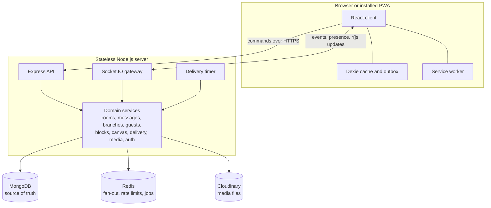
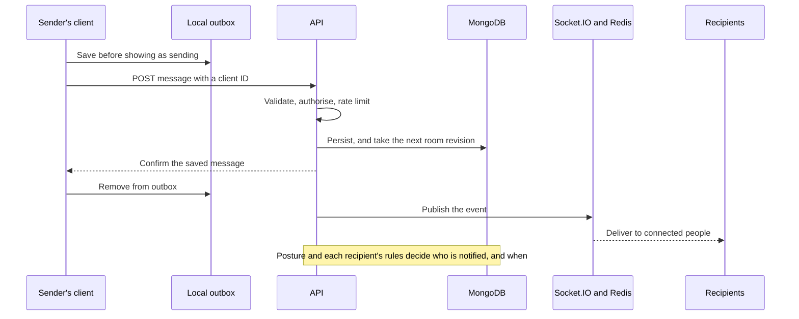

<div align="center">
  
  <h1>Strata</h1>
  <p><strong>Conversations should crystallize, not evaporate.</strong></p>
  <p>A real-time messaging and collaboration platform where decisions, plans and knowledge outlast the chat they came from.</p>
  <p>
    <a href="https://strata-0k8v.onrender.com">Live staging site</a> ·
    <a href="#features">Features</a> ·
    <a href="#architecture">Architecture</a> ·
    <a href="#getting-started">Getting started</a> ·
    <a href="docs/CHECKLIST.md">Project status</a>
  </p>
</div>

> The staging site runs on a free plan. After 15 minutes without traffic it sleeps, so the first visit can take about a minute.

## Why Strata exists

Chat is the fastest way for a group to reach a decision, and one of the worst places to keep it. A useful answer scrolls away. A side topic takes over the main thread. A plan ends up copied into a separate document, and the two drift apart. Bringing in an outsider means exposing the whole group. And every message interrupts everyone in the same way, however much it matters.

Strata keeps the speed of chat and fixes what happens next. It's built on four ideas:

| Pillar | The problem | Strata's answer |
| --- | --- | --- |
| **Communication** | Side topics derail the main conversation | Branch a topic away, then merge back only the outcome |
| **Collaboration** | Plans made in chat go stale or move elsewhere | Live checklists and rosters inside the conversation |
| **Context** | Decisions get buried in history | A Canvas that keeps what was settled, linked to where it was said |
| **Attention** | Every message interrupts equally | Senders declare intent, and recipients' rules decide what interrupts them |

## Features

### Signature features

#### Branch-and-Merge

Start a focused side discussion from any message, with its own title, participants and visibility. When it's finished, record a summary and merge it. The parent conversation receives one resolution card, exactly once, and is otherwise left untouched.

- Branches can be **listed**, so parent members can see that they exist, or **private**.
- Each branch moves through `open`, `resolved` and `archived`, with transitions enforced on the server.
- The transcript can optionally be shared with parent members after merging.

#### Live blocks

Checklists, sign-up rosters and info cards that everyone edits together, inside the conversation. They're built on Yjs CRDTs, so simultaneous edits converge and offline edits reconcile on reconnect.

The server validates each update instead of blindly relaying it, which is what makes a rule like "you can only sign yourself up" real. Blocks also keep a readable change history.

#### Stream-to-Canvas

Every conversation has a persistent knowledge layer alongside it. Any message can be added to the Canvas as a note, decision, link or quote, and organised into sections. Canvas items and their source messages link to each other in both directions.

#### Guest Bridges

Invite someone from outside into exactly one branch through a secure link, with no account or install. Links support read or write access, an optional PIN, an expiry date and instant revocation. Guests are a separate kind of user on a separate API, and the tests actively try to break out of that boundary.

#### Intent-Contract Delivery

Every message reaches the conversation. What the sender chooses is whether, and when, it interrupts people:

| Posture | Meaning |
| --- | --- |
| **Whisper** | Appears in the conversation, and never interrupts |
| **Digest** | Notifies once, in the recipient's next digest window |
| **Standard** | Notifies straight away, or when quiet hours end |
| **Blocking Acknowledgement** | Needs a response by a deadline, with a reminder, and the sender sees who has responded |

Each recipient's timezone, quiet hours and personal rules always have the final say.

### Everything else you'd expect

- **Messaging:** direct and group conversations, replies, reactions, editing, deletion, search and file sharing
- **Real-time:** typing indicators, presence, and delivery and read receipts
- **Offline:** cached conversations, plus an outbox that sends queued messages when the connection returns
- **Installable app:** a PWA with a dedicated mobile layout
- **Attention screen:** one place for requests waiting on you, digests and recent notifications

### Personalisation and privacy

- **Themes:** Violet and Emerald, each in dark, light or matching the device
- **App icon:** each person chooses their own, and the choice follows them across devices
- **Profile photos:** in-browser cropping, with public or private visibility
- **Privacy controls:** choose who sees your photo, or appear offline
- **Account security:** change your password, and review or sign out devices
- **Accessibility options:** text size and reduced motion

## Tech stack

| Layer | Technology | Why it's here |
| --- | --- | --- |
| **Language** | TypeScript, in strict mode throughout | One language and one set of types across the system |
| **Web client** | React 19, Vite, Tailwind CSS 4, Zustand, React Router | Fast builds, with design tokens in one stylesheet |
| **Offline** | Dexie (IndexedDB), Service Worker, Web App Manifest | Local cache, durable outbox and install support |
| **API** | Node.js, Express 5 | Straightforward commands with status codes and retries |
| **Real-time** | Socket.IO with the Redis adapter | Events reach people connected to any server node |
| **Collaboration** | Yjs | Conflict-free merging for live blocks |
| **Database** | MongoDB with Mongoose | The source of truth for all durable state |
| **Cache and jobs** | Redis, BullMQ | Socket fan-out, rate limits and background compaction |
| **Media** | Cloudinary signed uploads, or local disk in development | Behind a provider interface |
| **Contracts** | Zod, in a shared package | One definition validates both server and client |
| **Security** | Argon2, JWT, rotating refresh tokens, Helmet | See [the security model](docs/05-security-model.md) |
| **Testing** | Vitest, Playwright, axe | Real databases, real browsers and accessibility audits |
| **Delivery** | GitHub Actions, Render, Docker | Every change is tested and the image is built before merging |

## Architecture



### Key design decisions

| Decision | Why |
| --- | --- |
| **A branch is a room** | Messages, blocks, search and notifications work in branches with no extra code, and access is enforced in one place |
| **Commands over HTTP, events over sockets** | There's one path for validation, permissions and rate limits, and failures retry cleanly |
| **Persist, acknowledge, then broadcast** | Sockets only reduce latency, so a dropped event is repaired from the database |
| **One revision counter per room** | Catching up after a disconnect is a single query, with no replica set needed for correctness |
| **Receipts are watermarks** | Marking a room as read is one write, however many messages were read |
| **Yjs with server-side validation** | Block rules are enforced, not merely suggested by the client |
| **MongoDB holds delivery state, and a timer drives it** | Redis can be wiped without losing a deadline or digest |
| **Guests are a separate type of user** | Guest tokens are rejected by the member API outright |
| **Canvas uses optimistic concurrency, not a CRDT** | Whole items change rarely, and conflicts are easy to show clearly |

The full reasoning is in the [architecture decision records](docs/02-architecture.md).

### How a message travels



Retries are safe because a client ID can only create one message. If a live event is missed, the client catches up from its last known revision when it reconnects.

### Resilience

These failures were simulated against the production build, using real processes:

| Failure | Behaviour |
| --- | --- |
| Redis wiped or restarted | Deadlines keep firing, because their clock and data don't depend on Redis |
| Redis down | Messaging keeps working. Sign-in, registration and guest links return 503, so their rate limits can't be bypassed |
| Starting without Redis | The app starts normally and connects when Redis returns |
| MongoDB down | Requests fail within about 5 seconds, and the app reconnects by itself |
| App killed abruptly | Overdue work runs on restart, and clients reconnect by themselves |

## Security and privacy

- Passwords are hashed with Argon2, and refresh tokens rotate, with reuse detection.
- Permissions are enforced on the server. Resources you can't access return 404, so their existence isn't revealed.
- Guests can reach one branch only, and their messages are stripped of anything that points beyond it.
- Rate limits cover sign-in, messaging, search, uploads and guest links, and sockets have their own budget.
- A strict Content Security Policy applies, and production won't start with unsafe configuration.
- Profile photos are checked by their actual bytes, and going private retires the old address.

> **Strata is not end-to-end encrypted.** Messages are protected in transit and stored on the server, which can read them to power search and notifications.

Read the full [security model](docs/05-security-model.md), including its [known gaps](docs/05-security-model.md#known-gaps-before-public-launch).

## Project structure

```text
apps/
  server/        Express API, Socket.IO gateway and background jobs
    src/modules/ One folder per domain, each with its routes and service
    src/realtime Event fan-out, presence and block sync
    src/models/  Mongoose schemas and indexes
  web/           React client and PWA
    src/features One folder per product area
    src/state/   Store, offline cache and outbox
  e2e/           Playwright browser tests and accessibility audits
packages/
  shared/        Zod schemas, socket contracts and block definitions
docs/            Requirements, architecture, security and status
render.yaml      Free staging deployment
Dockerfile       Production image
```

## Getting started

**You'll need:** Node.js 22 or later, pnpm, and either Docker or the bundled development runner.

Install dependencies:

```bash
pnpm install
```

Create your `.env` file with fresh random secrets:

```bash
pnpm run setup
```

Start MongoDB and Redis with Docker:

```bash
docker compose up -d mongo redis
```

Or without Docker:

```bash
pnpm infra
```

`pnpm infra` runs a persistent MongoDB, and looks for Redis in `.tools/redis`, then on your PATH. On Windows with MSYS2, `scripts/build-redis-msys.sh` builds official Redis source into `.tools/redis`.

Run the app:

```bash
pnpm dev
```

Then open <http://localhost:5173>.

To create demo accounts and a starter conversation:

```bash
node scripts/seed-dev.mjs
```

The generated credentials are written to `.data/dev-accounts.json`, which git ignores.

### Commands

| Command | Purpose |
| --- | --- |
| `pnpm dev` | API on port 4000 and web on port 5173, with reload |
| `pnpm infra` | Local MongoDB and Redis without Docker |
| `pnpm test` | All unit, client and server tests, using real MongoDB and Redis on the server |
| `pnpm test:e2e` | Browser tests against the production build. Needs MongoDB and Redis running |
| `pnpm typecheck` | Type-check every package |
| `pnpm build` | Production builds |

## Testing

| Suite | Tests | Runs against |
| --- | --- | --- |
| Shared | 9 | Yjs documents |
| Server | 228 | Real MongoDB, Redis and Socket.IO clients, plus a second server process for multi-node behaviour |
| Web | 20 | Store and block session logic |
| Browser | 72 | Real Chromium on the production build, with its real Content Security Policy |

The browser suite fails on any page error or CSP violation. It also runs axe accessibility audits (WCAG 2.1 AA) in all four themes. [The checklist](docs/CHECKLIST.md) records what's verified, and the bugs that testing found.

## Deployment

Staging runs entirely on free plans:

| Piece | Service |
| --- | --- |
| App | Render web service, using the native Node runtime |
| Redis | Render Key Value |
| Database | MongoDB Atlas M0 |
| Media | Cloudinary |

`render.yaml` describes the whole setup. The [deployment guide](docs/07-deployment.md) has the steps, production configuration, and what the free plan costs in behaviour.

## Status and roadmap

Strata is suitable for private testing, and is **not yet ready for a public launch**.

**Before a public launch:**

- [ ] Email verification and password reset
- [ ] Two-factor authentication
- [ ] Abuse reporting and moderation
- [ ] Upload malware scanning
- [ ] Account deletion and data export
- [ ] External penetration test

**Still to verify live:** Cloudinary uploads, real push notifications, and behaviour on real phones. The [checklist](docs/CHECKLIST.md) tracks each of these.

**Future ideas**, deliberately not built yet, include a Decision Ledger, Time-Scrubber, Voice Chapters and Micro-Applets. The [architecture document](docs/02-architecture.md) lists the extension point for each.

## Documentation

| Document | Contents |
| --- | --- |
| [Development checklist](docs/CHECKLIST.md) | **Start here.** What's done, partial and pending |
| [Reference audit](docs/00-reference-audit.md) | What was learned from the reference repository |
| [Product requirements](docs/01-product-requirements.md) | Requirements and the branch visibility matrix |
| [Architecture](docs/02-architecture.md) | System design and decision records |
| [Data model](docs/03-data-model.md) | Collections, indexes and invariants |
| [API and events](docs/04-api-and-events.md) | REST and Socket.IO contracts |
| [Security model](docs/05-security-model.md) | Threats, controls and privacy implications |
| [Roadmap and risks](docs/06-roadmap-and-risks.md) | Phases and technical risks |
| [Deployment](docs/07-deployment.md) | Production configuration |
